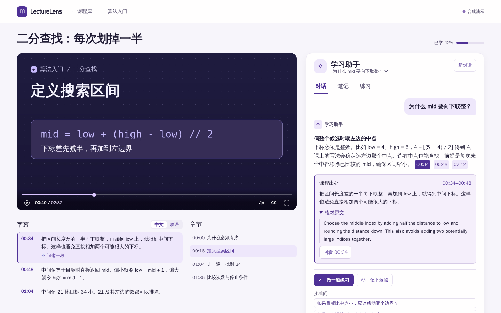
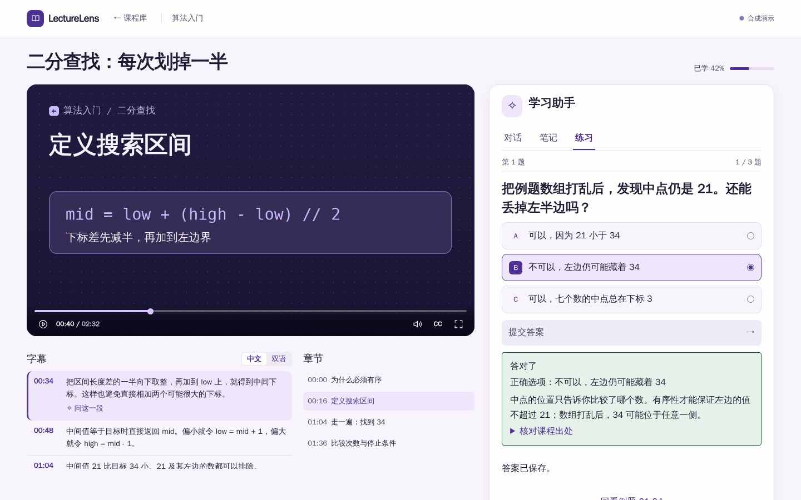
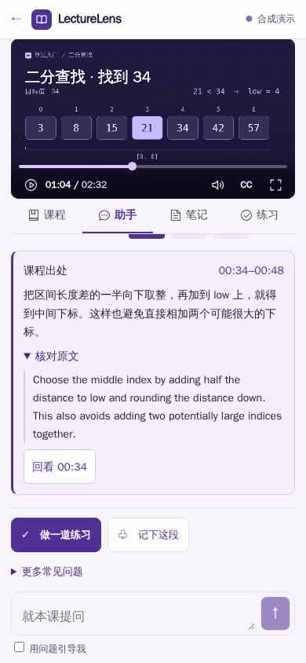
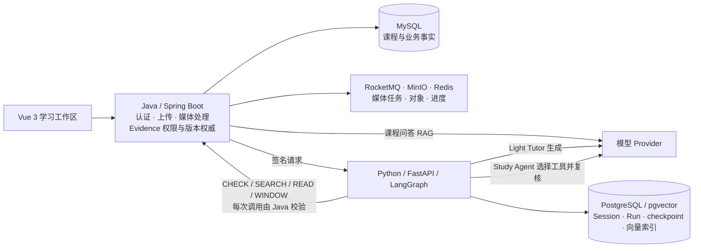

# LectureLens

LectureLens is an experimental Study Agent that helps you study lecture videos through synchronized transcripts, timestamped Tutor answers, and practice grounded in the course.



[Download the walkthrough (MP4)](docs/media/lecturelens-round3-mock.mp4?raw=true) · Deterministic Mock with a fixed, synthetic binary search lesson and English step captions.

## Core capabilities

- **Watch and read together.** Follow the translated transcript as the video plays, switch to bilingual text, or jump to a chapter or transcript segment. [Course navigation](docs/COURSE_POSITION.md)
- **Ask Tutor and replay the evidence.** Ask a course question, open a timestamped source to read the excerpt, then replay that point in the lecture. [Tutor](docs/P8_TUTOR.md)
- **Practice and review.** Submit a course-based multiple-choice exercise, see the result and its supporting excerpt, and revisit missed questions. [Exercises](docs/P9_EVIDENCE_CHOICE.md) · [Review](docs/P10_CHOICE_REVIEW.md)
- **Prepare your own material.** Import a lecture video, use embedded subtitles when available or run speech recognition, and prepare translations and study materials. [Media ingestion](docs/ARCHITECTURE.md#媒体摄取与异步任务)

## Quick start

On Linux or WSL2, install Docker Engine 28+ with Compose 2.24.4+, Java 21, Node.js 24 with npm, Python 3.12 or 3.13, [uv](https://docs.astral.sh/uv/), and FFmpeg. The first launch builds the app and downloads dependencies, container images, and the public embedding model. [Deployment guide](docs/DEPLOYMENT.md)

```bash
git clone https://github.com/a27497/lecturelens.git
cd lecturelens
python3 scripts/demo/round3/launch.py up
```

Open the local course library URL printed by the launcher and select the binary search lesson. The Round 3 demo seeds its own course and visitor session. It needs no model API key.

```bash
python3 scripts/demo/round3/launch.py down
```

## Known limitations

- The walkthrough uses scripted Tutor responses, fixed exercise content, and deterministic grading. It demonstrates the browser workflow. [Round 3 fixtures](fixtures/demo/round3/) · [Browser checks](frontend/tests/browser/round3Lesson.spec.mjs)
- Real-model Tutor and Study Agent quality remains experimental. Evaluation results apply to their recorded courses, candidates, and configurations. [Tutor trial](docs/LIGHT_TUTOR_TRIAL.md) · [Study Agent evaluation](eval/phase-completion/FINAL_AU.md)
- Long-course generation has not been validated. Open-ended automatic grading and long-term learner memory are planned. [Product scope and evaluation limits](docs/AGENT_PRODUCT_CONTRACT.md)

## Round 3 screenshots

**Desktop exercise result**



**Mobile Tutor source**



## 中文说明

LectureLens 是一个实验性的课程学习助手。导入视频后，系统优先使用内嵌字幕，无字幕时可调用 ASR，再生成译文、章节和学习资料。学习工作区支持视频与字幕双向定位；课程工具提供问答、闪卡、资料和 SRT / VTT / Markdown / JSON 下载。同一浏览器再次进入课程时，可以恢复上次的视图与视频位置。

Round 3 本地演示使用自写合成课程《二分查找：每次划掉一半》。进入课程后，可在「助手」提问，点击时间标记查看原文，再点「回看」定位视频。「笔记」保存在当前浏览器和账号下。「练习」支持提交选择题、查看判分和对应的课程证据。启动与停止命令见 [Quick start](#quick-start)。

### 架构



- **Java 管课程事实与权限，Python 管执行。** Java 校验课程所有权及 Evidence 版本和删除状态。Python 管理 Agent 执行与派生索引。
- **课程问答、Tutor 与 Study Agent 各有独立路径。** 课程问答走检索增强生成；Light Tutor 走单次生成；Study Agent 根据检索或工具结果决定下一步，并在发布学习产物前复核。
- **Study Run 的预算与恢复状态持久化。** 调用前记录预算，恢复后继续沿用；未通过复核的草稿不发布。取消、恢复与执行记录见[审批与恢复](docs/STUDY_APPROVAL_RECOVERY.md)。

参见[架构文档](docs/ARCHITECTURE.md)、[设计取舍](docs/DESIGN_TRADEOFFS.md)和[仓库导览](docs/PROJECT_MAP.md)。

### 能力状态与验证

- **已实现。** 视频摄取与资料导出、字幕定位、课程问答、Evidence 权限与版本校验，以及 Study Session / Run 持久化。课程问答需要有效的当前课程引用。引用通过系统校验后，读者仍应核对原文是否支持回答。 [课程问答评测](eval/l4-benchmark/README.md) · [跨用户隔离实验](eval/multi-user-phase-e/README.md)
- **实验性。** Study Agent 的解释与练习、Light Tutor、作答后的证据反馈。Round 3 多轮 Tutor、证据闪卡和错题回看使用 Mock 数据。 [Study Agent](docs/L2_STUDY_AGENT.md) · [学习交互](docs/L3_LEARNING_FLOW.md) · [证据闪卡](docs/P7_EVIDENCE_FLASHCARDS.md)
- **计划中。** 开放题自动评分、长期学习记忆、在未见课程上的系统性评测。 [产品阶段](docs/PRODUCT_STAGES.md)

[L4 基准](eval/l4-benchmark/README.md)保留课程问答、Light Tutor 和 Study Agent 在固定数据及配置上的历史对照，包括产品失败和引用核查限制。[评测索引](eval/README.md)保留候选、冻结数据和失败试验。[CI 配置](.github/workflows/ci.yml)记录自动化检查与文档变更的触发规则。长时课程生成尚未验证。

如需给自己的课程配置模型，见[部署指南](docs/DEPLOYMENT.md)和[试学说明](docs/LIGHT_TUTOR_TRIAL.md)。Java 媒体链路可单独启动，见 [Quick Start](docs/QUICKSTART.md)。全部文档见[文档索引](docs/README.md)。

## License and credits

The code uses the [MIT License](LICENSE). The walkthrough and screenshots use the original synthetic [Round 3 course](fixtures/demo/round3/). Historical MIT OpenCourseWare captures retain their source license and attribution in the [product gallery](docs/PRODUCT_GALLERY.md).
