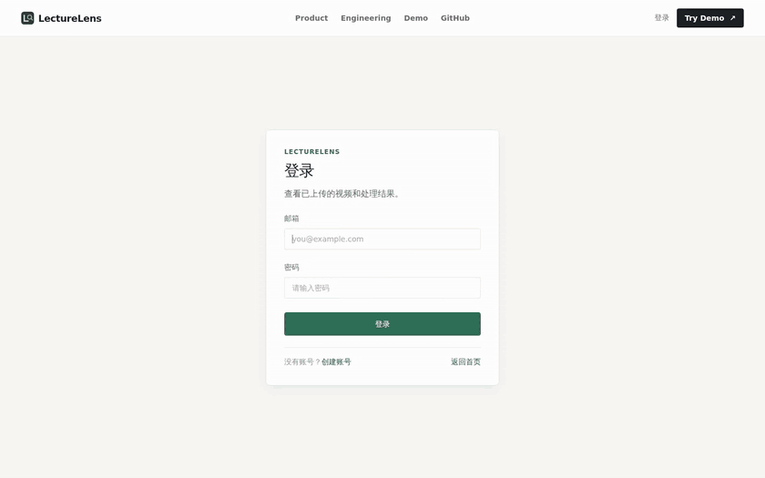
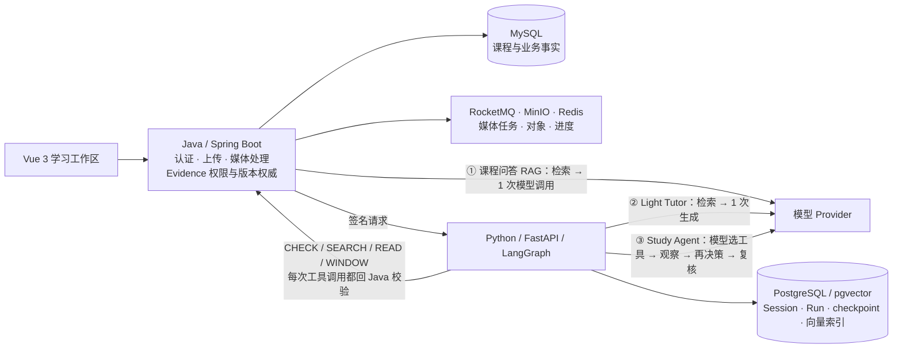

# LectureLens

**课程视频学习助手：回答和练习都必须能指回课程里的原话和时间点。**

> **English summary.** LectureLens turns a lecture video into subtitles, translations and study material, then answers questions and builds practice that cite timestamped course evidence. A Java service owns courses, media and evidence authority; a Python LangGraph service runs a budgeted, fail-closed Study Agent. On an AI-authored benchmark (6 MIT OCW lectures, 96 questions × 3 runs) the single-call Light Tutor scored best on strict correctness (0.718); the Study Agent scored 0.426 because 83 of its 288 runs ended in product errors. `scripts/demo/up.sh` starts the whole stack with deterministic mock providers and no API key.

[](https://github.com/a27497/lecturelens/actions/workflows/ci.yml)
[](LICENSE)



<sub>**Real · deepseek-flash**，66 秒，合成课程（自写字幕，见 [fixtures/demo](fixtures/demo/)）。每一帧底部标注模式和步骤。[MP4 版本](docs/media/lecturelens-walkthrough-real.mp4)；录制脚本 [record-demo.mjs](scripts/demo/record-demo.mjs)，从实例状态读取模式和模型，任何一步没有达到预期结果就以非零状态退出。录制与调试的模型费用合计不超过 USD 0.03（[记录](eval/demo-stack/README.md)）。</sub>

## 它做什么

1. **把视频变成可读的课程**：上传视频，优先使用视频内嵌字幕（没有时才调用 ASR），生成译文、学习资料和可导出的 SRT / VTT / Markdown / JSON。视频与原文时间轴双向定位。
2. **有依据地回答**：课程问答只引用当前课程的 Evidence（带来源编号和时间范围），点击引用跳回视频。课程没讲的内容拒答，不编造。
3. **解释、练习和反馈**：Study Agent 按学习目标自己选择检索、补读、出题等工具，草稿经复核才发布；作答保存为不可变版本，反馈引用课程原文。

## 架构



- **Java 管事实，Python 管执行。** 课程所有权、Evidence 版本和删除状态只由 Java 判定；Python 的索引和缓存不能授予访问权。Python 不读写 MySQL，Java 不写 Agent 表。
- **三条问答路径分开。** 媒体处理是确定性的准备流程；课程问答是单轮 RAG；只有 Study Agent 是“模型选工具、读观察、决定继续或停止”的循环。
- **有界、可恢复。** 每个 Study Run 最多 12 次模型调用、8 次工具执行、90 秒；预算在调用前写入 PostgreSQL，崩溃恢复不会重置。复核不合格就失败，不降级发布。

为什么这样分、放弃了什么，见[设计取舍](docs/DESIGN_TRADEOFFS.md)。组件细节见[架构文档](docs/ARCHITECTURE.md)，源码入口见[仓库导览](docs/PROJECT_MAP.md)。

## 质量：三条路径的对照测量

| 指标（留出集，96 题 × 3 次） | 课程问答 RAG | Light Tutor | Study Agent |
| --- | --- | --- | --- |
| **严格正确率**（主指标） | 0.417 [0.31, 0.52] | **0.718** [0.62, 0.81] | 0.426 [0.34, 0.52] |
| 实质错误率（已作答的可答题） | 0.186 | 0.080 | 0.024 |
| 引用召回 / 引用精确率（ALCE 逐对） | 0.881 / 0.537 | 0.827 / 0.883 | 0.976 / 0.255 |
| 拒答准确率 | 0.931 | 0.941 | 0.677 |
| 产品自身失败 | 0 / 288 | 1 / 288 | **83 / 288** |
| P50 延迟 | 1.10 s | 4.45 s | 14.5 s |
| 每题成本 | USD 0.00037 | USD 0.00075 | USD 0.0074 |

所有数字来自 [eval/l4-benchmark](eval/l4-benchmark/README.md) 和 [results.json](eval/l4-benchmark/results.json)。读这张表时要同时看下面几条：

- **这是合成基准。** 题目和金标准由 AI 依据官方字幕撰写，经 Codex 全量内容审核，没有人工标注。课程是 6 讲 MIT OpenCourseWare（3 门课），共 96 题（72 道可答、24 道应拒答），每题跑 3 次。区间是按讲次分层的 bootstrap，不覆盖“换一批课程”的不确定性。
- **只用于比较产品路径，不用于给模型排名。** 三条路径都用 `deepseek-flash`。
- **裁判与被测模型同厂商，且偏宽松。** 裁判是 `deepseek-v4-pro`。在 20.6% 的盲审复核样本上，裁判判对、复核者判错的有 18 条，反方向只有 1 条（判定一致率 88.2%，κ 0.75）。按复核尺度缩放后，RAG 约 0.31、Tutor 约 0.59、Study 约 0.26，排名不变。
- **Study Agent 的 288 次 Run 中有 83 次产品自身失败**（63 次复核输出不合规 `MODEL_REVIEW_CONTRACT`，11 次超预算），全部按错误计。它成功产出的可答题里，严格正确 92/126（探索性指标）。
- Tutor 领先 RAG +0.30、领先 Study +0.29（Bonferroni 校正区间不含 0）。RAG 与 Study 的差异没有结论（−0.01，区间 [−0.14, +0.12]）。

基准暴露的问题都还没修，列在[设计取舍 · 局限](docs/DESIGN_TRADEOFFS.md#7-l4-暴露的局限仍然存在)。评测工具的代码审查分诊见 [HARNESS_REVIEW.md](eval/l4-benchmark/HARNESS_REVIEW.md)。

## 能力状态

**已实现**

| 能力 | 证据 |
| --- | --- |
| 上传、内嵌字幕优先 / ASR、翻译、学习资料、四种格式导出 | [架构 · 媒体摄取](docs/ARCHITECTURE.md#媒体摄取与异步任务)；CI 中真实基础设施上的 [Mock AI E2E](scripts/ci/mock-e2e.py) |
| 课程问答：只引用当前课程 Evidence，无证据时在调用模型前拒答 | [质量对照](eval/l4-benchmark/README.md)；[架构 · 课程问答](docs/ARCHITECTURE.md#课程阅读qa-与浏览器恢复) |
| 课程所有权、Evidence 版本与删除校验，跨用户隔离 | [多用户隔离实验](eval/multi-user-phase-e/README.md) |
| 视频与原文时间轴双向定位、引用跳转 | [课程定位说明](docs/COURSE_POSITION.md) |
| Session / Run 持久化、取消、崩溃恢复、公开执行记录 | [审批与恢复](docs/STUDY_APPROVAL_RECOVERY.md)；[Trace / Replay](eval/agent-trace-phase-b/README.md) |
| 一键本地演示（Mock 默认，可选真实模型） | [一键启动](#一键启动)；[stack.py](scripts/demo/stack.py) |

**实验性**

| 能力 | 状态 | 证据 |
| --- | --- | --- |
| Study Agent：解释 + 两道练习 | Real 测量过；失败率 29% | [质量对照](eval/l4-benchmark/README.md)；[执行说明](docs/L2_STUDY_AGENT.md) |
| Light Tutor：单次生成的课程讲解 | Real 测量过（基准直接调用运行时）。产品里只作为单用户、需费用授权的试学入口 | [Light Tutor](docs/LIGHT_TUTOR.md)；[试学](docs/LIGHT_TUTOR_TRIAL.md) |
| 作答证据反馈 | 真实模型只在一门已知公开课程片段上验收过 | [学习交互](docs/L3_LEARNING_FLOW.md)；[浏览器验收](eval/recruiter-demo-phase-d/README.md) |
| 多轮课程 Tutor 面板 | **只有 Mock** | [说明](docs/P8_TUTOR.md) |
| 证据闪卡与 FSRS 复习调度 | **只有 Mock** | [说明](docs/P7_EVIDENCE_FLASHCARDS.md) |
| 原文选择题与程序判分、答错待回看 | **只有 Mock**（判分是确定性比较） | [选择题](docs/P9_EVIDENCE_CHOICE.md)；[答错待回看](docs/P10_CHOICE_REVIEW.md) |
| 系统级模型管理 | 默认关闭 | [说明](docs/SYSTEM_MODEL_MANAGEMENT.md) |
| Course 工具走 MCP stdio 传输 | 可选，默认 internal | [实验](eval/course-mcp-phase-c/README.md) |

**计划中**

- 修复基准暴露的三处缺陷：Study 复核输出不合规、RAG 漏召回时不返回结构化拒答、Study 练习引用过多。修复后需要新的留出集重新测量。
- 开放题自动评分、长期学习记忆。
- 在未见过的课程上做系统性评测。

## 一键启动

前提：类 Unix 环境（只在 Linux 上实测过；macOS 应该可用但没有测；Windows 请在 WSL2 里运行，原生 Windows 不支持），Docker Engine 28 或更高（更早的版本上，同一局域网的机器可以访问绑定在 127.0.0.1 的容器端口）、Compose 2.24.4 或更高，Java 21、Node.js 24、Python 3、[uv](https://docs.astral.sh/uv/)、FFmpeg。

```bash
git clone https://github.com/a27497/lecturelens.git
cd lecturelens
scripts/demo/up.sh          # Mock 模式：不需要任何 key，没有外部模型调用
```

脚本会构建 Java / 前端、同步 Python 依赖、下载公开的嵌入模型（[固定版本](scripts/demo/stack.py)），启动 MySQL、Redis、MinIO、RocketMQ 和 PostgreSQL，再启动三个应用进程，最后导入演示课程并等待索引就绪。完成后终端打印课程地址和本地演示账号；密码是 `.demo/stack-<instance>/secrets.json` 里的 `DEMO_PASSWORD`（文件仅本人可读）。所有端口只监听 `127.0.0.1`；默认端口被占用时自动换一个并打印出来。

- **[实测](eval/demo-stack/README.md)**：在一台 8 核 / 16 GB 的 Linux 机器上，全新 clone 到可以提问用时 **90 秒**（Maven、npm、uv 缓存和 Docker 镜像已在本机）。第一次在新机器上运行要下载依赖和镜像，并从源码构建 MinIO 镜像，耗时会长得多。
- **内存**：每个容器都有硬上限，JVM 堆已压低，整套服务实测峰值 **2.9 GB**（[明细](eval/demo-stack/README.md#内存上限)）。建议 8 GB 内存的机器；启动时可用内存低于 4 GB，`up.sh` 会拒绝启动（确认要继续时设 `LECTURELENS_DEMO_IGNORE_MEMORY=1`）。8 GB 是按实测峰值加浏览器估算的建议，没有在 8 GB 机器上实测。
- **Mock 模式的含义**：Java 使用确定性演示 LLM，Agent 使用 `AGENT_LLM_MODE=mock`。界面上标注“本地演示 · 无外部 AI”和“Mock 流程测试”。Mock 只验证流程，回答内容是固定模板，也演示不了真正的拒答（Mock 总是引用检索到的第一条证据）。
- **停止**：`scripts/demo/down.sh` 停止进程并删除容器，保留数据卷；加 `--purge` 同时删除数据卷和生成的本地密码。用 `--instance <name>` 启动的实例，停止时要带同样的参数，例如 `scripts/demo/down.sh --instance real`；`up.sh` 结束时打印的停止命令总带 `--instance`。启动中途失败时，脚本会自动停掉这次启动的进程和容器。
- **只动自己创建的资源**：脚本只管理 `lecturelens-demo-<instance>` 和 `lecturelens-demoagent-<instance>` 两个 Compose 项目，并给其中每个容器和数据卷打上本次 clone 的归属标签。同名项目里只要有一个容器或数据卷不带这个标签（例如 Quick Start 起的栈或另一个 clone 留下的栈），`up.sh` 拒绝启动，`down.sh` 不删除该项目的任何东西，并列出这些资源。

### 真实模型模式

```bash
export LECTURELENS_LLM_API_KEY=...          # 必需：你自己的 OpenAI-compatible key
export LECTURELENS_LLM_BASE_URL=https://api.deepseek.com   # 可选，默认值
export LECTURELENS_LLM_MODEL=deepseek-flash                 # 可选，默认值
scripts/demo/up.sh --real --instance real
```

Java 的翻译、学习资料、章节和课程问答，以及 Agent 的决策和复核，都使用这个模型。Java 端默认使用同一个地址（地址里没有路径时，Java 自己补 `/v1`；有路径时原样使用），可用 `LECTURELENS_JAVA_LLM_BASE_URL` 覆盖。key 只传给子进程，不以明文写入磁盘或日志。Agent 会把 key 加密后保存在每个真实 Study Run 的模型配置里（PostgreSQL 数据卷），`down.sh --purge` 会删除它。两个地址都必须是 https，本机地址也不例外，因为 key 在请求头里。演示课程自带字幕，所以不会调用 ASR。同一个实例在 Mock 和真实模式之间切换时，会重新导入一门课程，不复用另一种模式生成的学习资料。真实模式下多轮 Tutor 面板关闭（它只有 Mock）。导入演示课程加上一遍录屏流程，[实测](eval/demo-stack/README.md)花费约 USD 0.007。

完整的手动部署（自己的 ASR、视觉模型、OCR、端口映射）见[部署指南](docs/DEPLOYMENT.md)。只起 Java 媒体链路的轻量演示见 [Quick Start](docs/QUICKSTART.md)。

## 验证与证据

自动化检查：每次 push / PR 运行 [CI](.github/workflows/ci.yml)，包括 Python lint 和真实 PostgreSQL 测试、Java 测试、前端单测 / 构建 / 依赖审计，以及真实基础设施上的 Mock AI E2E。确定性 Provider 只验证执行机制，不代表模型质量。

历史验证结果（各自对应当时的提交，不是当前提交重新运行的成绩）：

| 结果 | 范围与来源 |
| --- | --- |
| 2,067 项自动化测试通过 | 2026-09-22 冻结版本的 Java、Python / PostgreSQL、前端测试合计；[验收记录](HUMAN_ACCEPTANCE_REPORT.md#job-search-freeze) |
| 2,160 次负向授权请求，0 次越权 | 跨用户、课程、Evidence、Run 的指定路径；[隔离实验](eval/multi-user-phase-e/README.md) |
| 真实模型学习闭环浏览器验收 | 一门已知 MIT OCW 公开课程片段，解释、引用、课程外拒答、作答、反馈、执行记录；[浏览器验收](eval/recruiter-demo-phase-d/README.md) |
| 默认使用 Dense 检索 | 离线检索对照选出，检索指标不等于答案质量；[检索实验](eval/retrieval-phase-a/README.md) |

更早的候选、失败试验和冻结数据见[评测索引](eval/README.md)；验收报告保留历史故障和已知问题，见 [HUMAN_ACCEPTANCE_REPORT.md](HUMAN_ACCEPTANCE_REPORT.md)。全部文档的分类索引见 [docs/README.md](docs/README.md)。

## 项目范围

这是一个可以自己部署的实验项目，没有在线服务。作答反馈是可核对的学习建议，不是自动评分。质量结论只覆盖上面写明的课程和配置，未见课程的泛化没有系统性验证。

## License & credits

代码使用 [MIT License](LICENSE)。

演示 GIF 和一键启动使用的课程是为本项目自写的合成内容（[fixtures/demo](fixtures/demo/)）。[产品截图](docs/PRODUCT_GALLERY.md)中的历史课程片段来自 Ana Bell 的 [MIT OpenCourseWare 6.0001, Lecture 3](https://ocw.mit.edu/courses/6-0001-introduction-to-computer-science-and-programming-in-python-fall-2016/resources/lecture-3-string-manipulation-guess-and-check-approximations-bisection/)，按 [CC BY-NC-SA 4.0](https://creativecommons.org/licenses/by-nc-sa/4.0/) 用于非商业展示；基准使用的 MIT OCW 讲次只公开哈希和汇总结果，字幕原文不在仓库中。MIT 不为本项目背书。图片与课程内容不因代码采用 MIT License 而改变原有授权。
