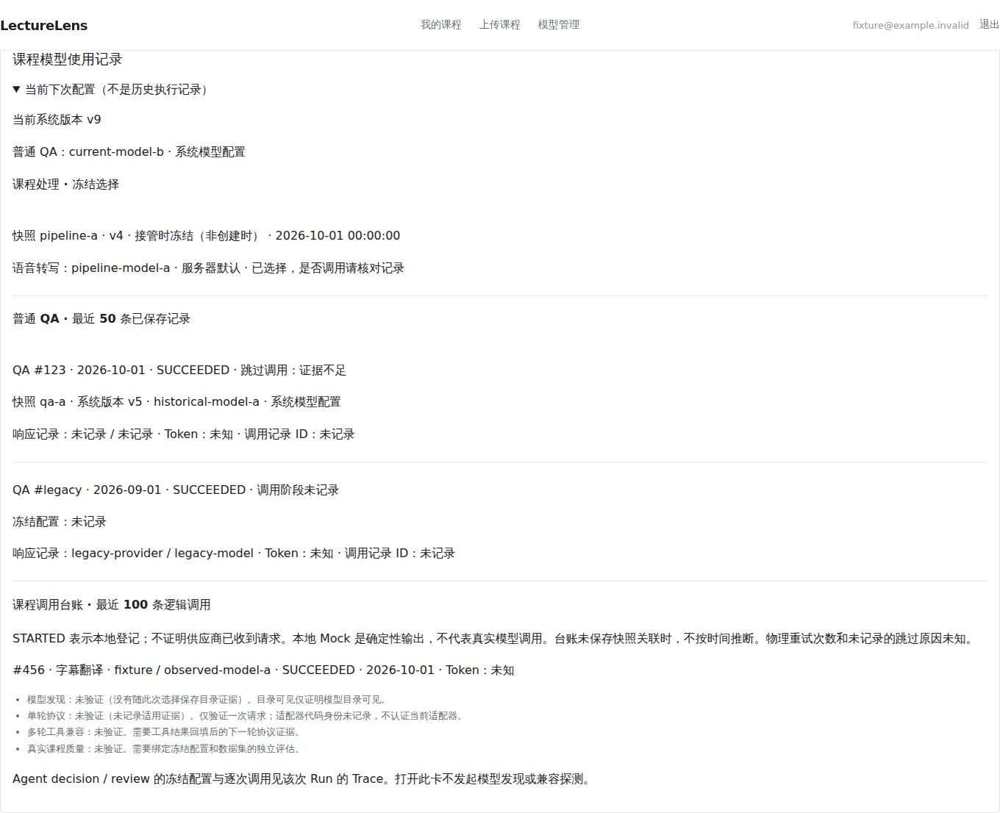
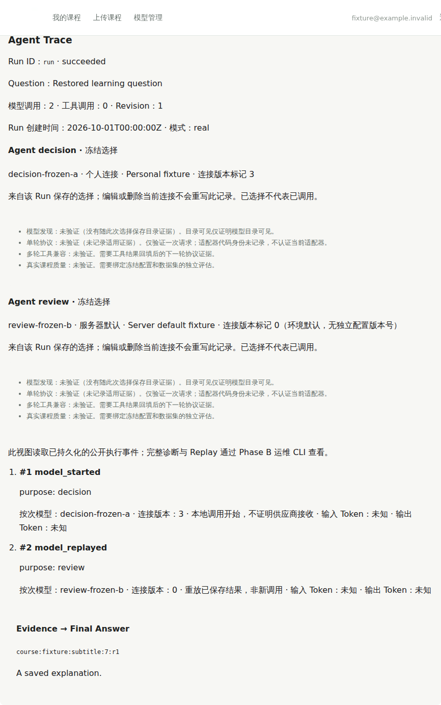
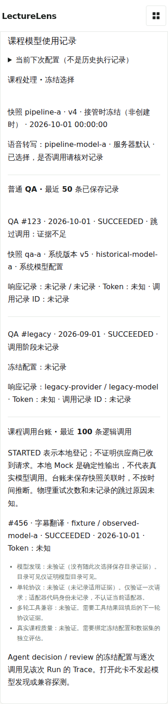

# vNext PR3 机制验证

基线 `20fc374fe856c937a925fccfafd54b8a9502187d`；实施位于独立工作树。基线 CI run 39807883799 四项成功。没有部署、生产 DDL、真实学习数据访问或付费模型调用；没有修改 #35/#36、Provider 绑定、预算或自动切换策略。

| 检查 | 实际结果 |
| --- | --- |
| Java 完整回归 + 隔离 MySQL 8.4 | 1,639 通过，0 失败，0 跳过；最终 QA 失败响应保留与只读接口改动另经 46 项定向测试通过 |
| PR3 MySQL 升级、权限、回滚 | 最终 4 项通过，0 跳过；覆盖下列迁移矩阵 |
| PR2 明确执行的 MySQL 集成目标 | 1 项通过；使用独立容器内专用 lecturelens_pr2_test |
| Python 完整回归 + 隔离 PostgreSQL 17/pgvector | 750 通过，0 跳过；只使用确定性 Provider/embedding 夹具 |
| Python 静态检查 | ruff check 与 format --check 通过 |
| 前端完整回归 | 179 通过；随后新增旧投影缺少连接身份的测试，最终模型卡/Trace 定向 9 项通过 |
| 类型检查与构建 | vue-tsc 和 Vite 通过；沿用已有的大 chunk 提示 |
| 依赖审计 | npm audit：0 vulnerabilities；没有新增依赖 |
| Chromium 新模型卡 | 5/5：当前/历史分离、双用途、权限失败清除、晚到响应隔离、390px |
| Chromium PR1 回归 | 10/10：本地解码视频、65 分钟/10,000 区间、位置、引用、草稿、切课、窄屏 |
| Chromium PR2 复核回归 | 9/9：原生拖动、版本失效、晚到验证、严格引用围栏、失败后恢复 |

浏览器使用真实 Chromium 153 与本地合成 H.264 视频，业务/Agent API 是明确的合成夹具；外部请求被阻断。它验证交互机制，不替代真实 Provider 或端到端教学质量。Java 的现有管理员权限负向测试与新增 owner 投影/真实数据库负向检查分别验证管理目录、跨 owner/课程、伪造快照引用、删除和未认证拒绝；卡片 DTO 不返回地址、凭据、keyLast4、完整配置或全局 catalog。

迁移矩阵实际使用 MySQL：空库、既有 V24 升级（原系统集成测试）、V25 旧 QA NULL、MyBatis 写入精确引用、配置 A→B 后历史 QA 仍引用 A、PR3→#35 V26–V31、#35 V26–V31→PR3、重复 migrate 无操作，以及基线 V1–V25 + 外部原样 R 文件的回滚 validate/migrate。#35 六份测试 SQL 与固定 HEAD `146cc883f045d89a87cfe9b083376c8dac204964` 逐字相同；所有历史生产 V 文件与 main 相同，未使用 outOfOrder 或 repair。SHA-256 见 [验证清单](verification.json)。这不合并或验收 #35 的运行代码。

回滚保留三个可空字段、原样 repeatable 文件、配置/快照/Run/调用历史。使用基线旧 JAR 时，额外提供原样 R migration bundle 供 Flyway 解析已应用历史；先 validate，再按既有发布审批与 worker 围栏操作。不要 DROP、清空或 repair。详见[当前行为与迁移约束](../../MODEL_USAGE.md)。

没有抹去初次失败：Python 第一次为 749 通过/1 个库名白名单拒绝，第二次收到 SIGTERM 后取消并完成清理，第三次完整 750 通过；PR2 MySQL 首次明确目标拒绝错误的专用库名，正确库名运行通过；format 首次仅新增测试文件排版失败，格式化后通过。新浏览器首次缺失测试 API 路由，修复夹具后通过；PR1 首次 65 分钟 metadata 默认 5 秒等待不足，下一次遇到跨进程采样错过 2–3 秒片段，最终使用媒体事件循环暂停和独立 metadata 等待，保持相同位置/解码断言后 10/10。原始终态、输出 hash 和后续通过分别列在验证清单中，完整本地日志留在仓库外。

剩余边界：处理台账尚无逐次物理调用与快照的可靠关联，界面明确不猜测；旧记录缺少信息为未记录，缺少 usage 为未知。发现结果未随执行保存，Java 探针未持久化供此卡使用；多轮真实 Provider 兼容和真实课程质量均为未验证。个人连接单次观察没有适配器代码身份，不能认证当前适配器。没有真实 Provider 费用授权，也没有新增费用硬限。

下面截图只使用合成账号与模型，不能作为真实云模型认证：

