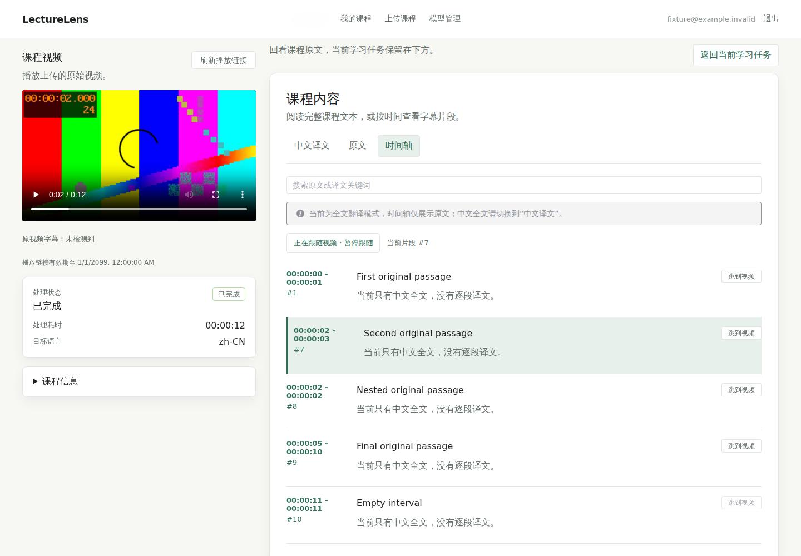
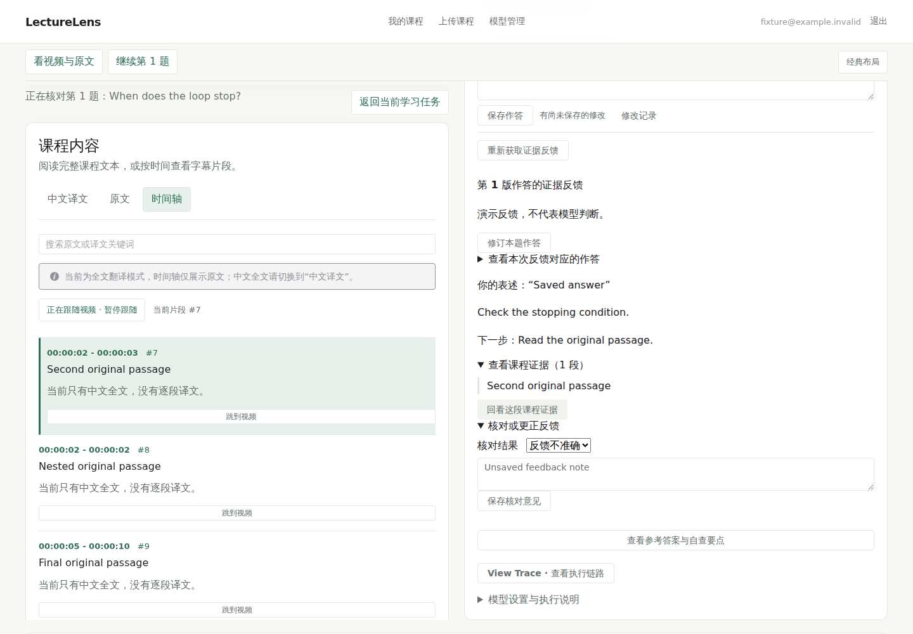
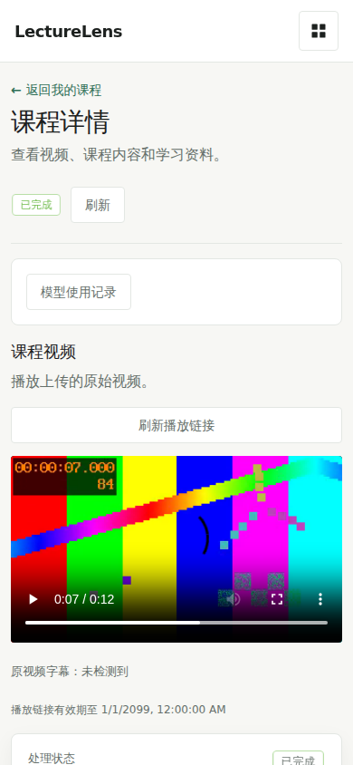
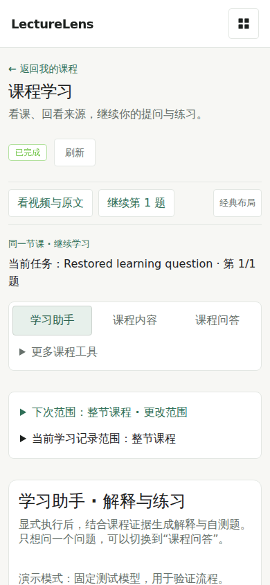
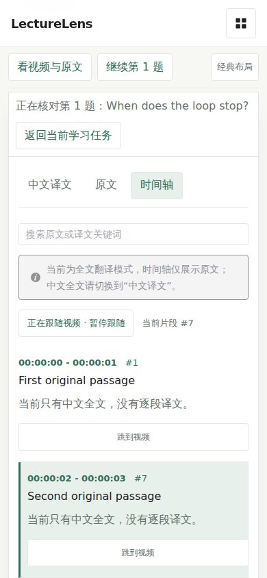
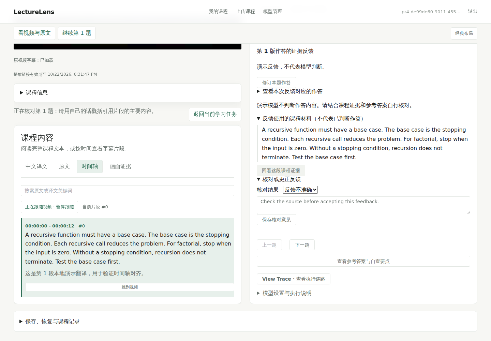
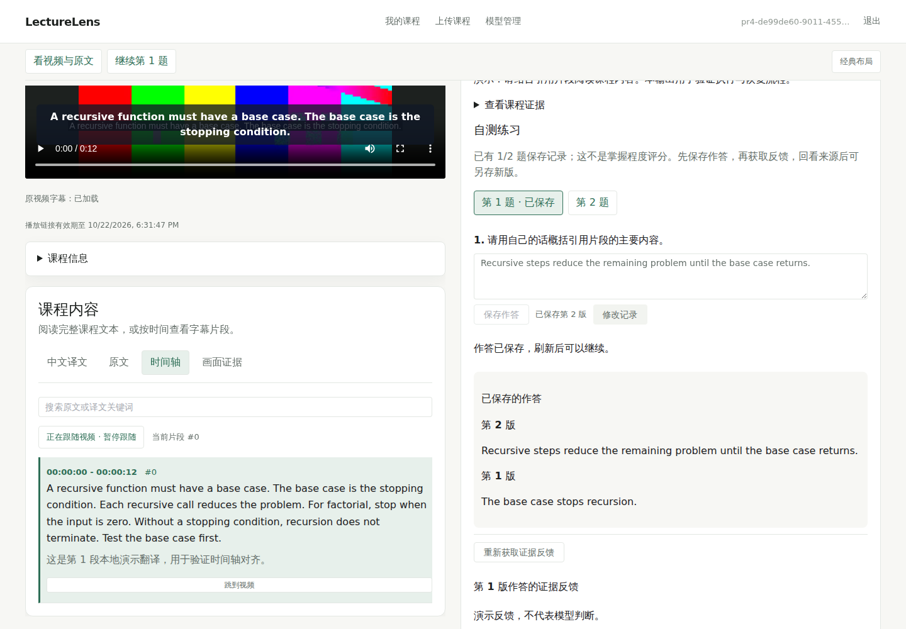
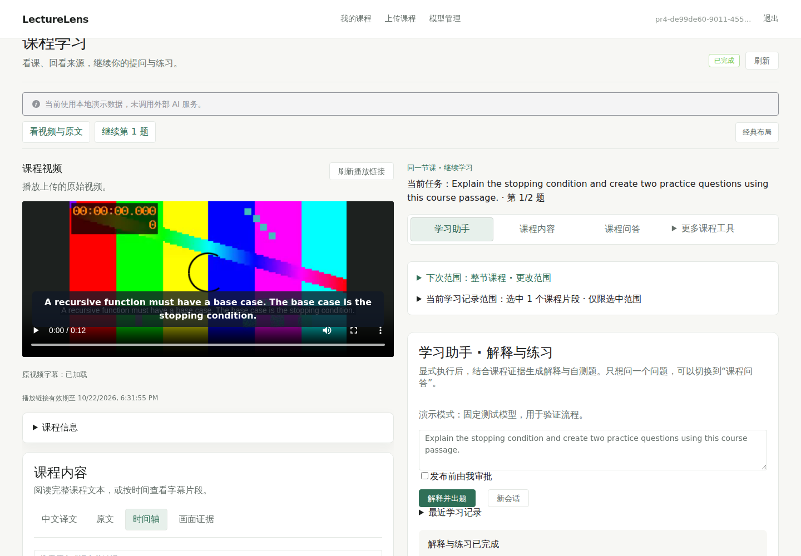
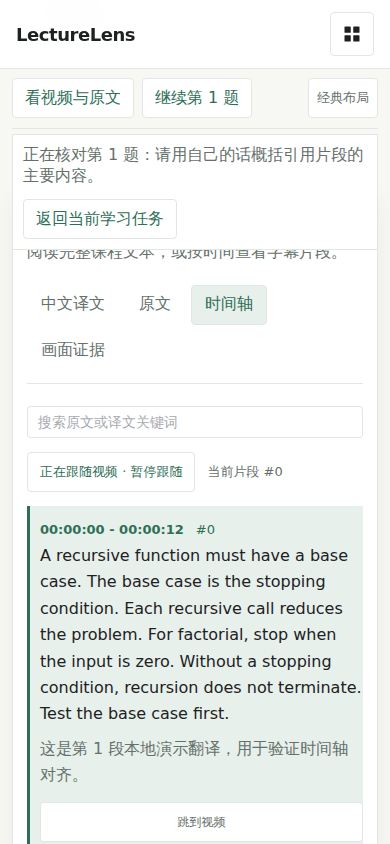
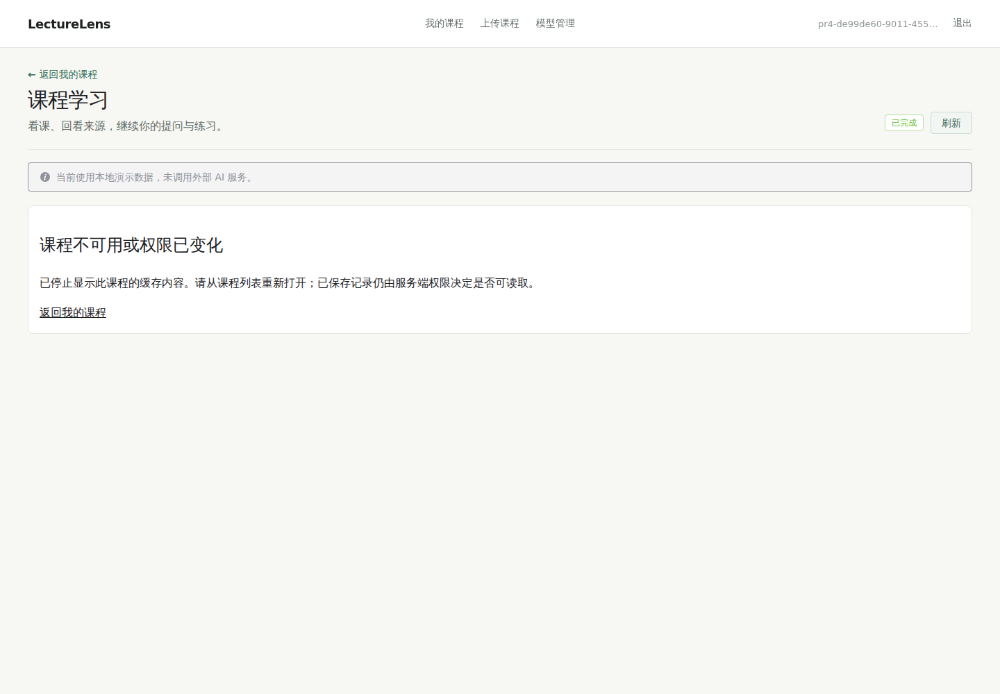

# PR4 continuous workspace verification

Base: `9e21a0ba5cab56703c69e7f0c7c8e7bee5cc0f1c`; its main CI run [39822782858](https://github.com/a27497/lecturelens/actions/runs/39822782858) has four successful jobs. Implementation uses an independent clean worktree, isolated build directories, databases and Chromium 153. No deployment, production DDL, paid model, real-provider probe, #35/#36 integration or migration change occurred. Java and Python production sources are unchanged.

## Baseline and same-task comparison

The baseline audit ran before implementation against the exact base build. Business API responses in the **comparison screenshots** are synthetic fixtures; video decode is real. Both versions perform the same sequence: open course → enter goal/answer/note drafts → click feedback source → return → ordinary QA → its source → repeat at 390px. Source review already retained drafts and restored focus on main; PR4 does not claim to have invented that behavior.

| Operation | Actual baseline | Actual candidate |
| --- | --- | --- |
| Feedback source and current task | Source inserted above task; question/feedback leave viewport | Source on the left and existing feedback on the right; drafts retained |
| 390px initial task | Goal top 1667.67px; question top 2163.47px | Goal top 862.17px; question top 1506.75px; sticky “继续第 1 题” focuses the active answer |
| Narrow source return | Return action, no current-question summary | Current-question summary, keyboard return and retained drafts |
| Ordinary Tutor QA | Separate QA, no Session/Run creation | Same separate path, no Session/Run creation |
| Denied owning-course read | Injected 404 + refresh left cached artifact/answer visible | Confirmed course denial unmounts cached panes/player; unit negatives and actual isolated deletion verify this |

These are observed positions/steps, not measured learning efficiency or a percentage improvement. No claim of automatic draft recovery after reload is made. The comparison uses a guidance fixture; the real Mock feedback below abstains.

Before / after desktop source review:





Before / after 390px entry, and source review:







## Real isolated backend journey

`frontend/tests/browser/learningJourney.mjs` uses actual Java/MySQL and Python/PostgreSQL APIs, the actual signed Evidence authority/sync/retrieval path and real browser media decode. It registers synthetic accounts, uploads a synthetic 12-second H.264/AAC/embedded-subtitle course through the chunk APIs and waits for processing/index readiness. Models use the existing explicit Mock Provider; embeddings use a deterministic hash implementation in the isolated app factory. Translation and generated practice/feedback are deterministic demo outputs. No business API fixtures or direct database inserts replace the main journey.

The runner is deliberately restricted to the isolated Java `127.0.0.1:38434` and browser proxy `127.0.0.1:18436`. Provision an independent stack with Mock-only settings and synthetic signing credentials before using it; never repoint it to production. Browser external requests are blocked. Example after provisioning, from `frontend/` under the development check supervisor:

```bash
node tests/browser/learningJourney.mjs --dist /isolated/pr4/dist \
  --media /isolated/pr4/course-with-embedded-subtitles.mp4 \
  --chromium /path/to/chrome --output /isolated/pr4/journey
```

The completed sequence and actual command paths/statuses are recorded in [journey.json](journey.json):

1. Restore a URL video coordinate, decode/play/pause, select one canonical segment with strict policy.
2. Submit scoped course QA. Confirm its evidence and zero Sessions; enter an unsaved follow-up, review source and return.
3. Explicitly start Study. Compare saved frozen one-segment scope; receive explanation and two questions.
4. Save answer v1, explicitly request feedback. Mock correctly abstains from semantic assessment; its recorded materials remain accessible.
5. Enter unsaved goal/answer/note, click feedback source, compare source and feedback in the desktop viewport, return. No write occurs during review.
6. Save answer v2 with a different attempt ID. Keep v1 in actual ATTEMPT_HISTORY; feedback remains on v1. Save a disputed note.
7. Change the next scope to whole course; READ confirms the original Run scope unchanged.
8. Reload the document. Actual READ restores the same Run, answer v2, feedback→attempt v1 and disputed note. Unsaved goal is discarded. No additional write occurs.
9. At 390px, use keyboard Enter on source and return; active source intersects the viewport and unsaved answer/note remain.
10. Delay the response from an actual READ, switch courses, reject late old-course state. A second real owner receives 404 for course, Evidence and session reads.
11. Restore the first course; delete it through its authorized API and refresh. Cached artifact and player disappear. Delete the second synthetic course.

Exactly one CREATE_SESSION, one START, two SAVE_ATTEMPT, one START_FEEDBACK and one SAVE_FEEDBACK_NOTE were observed from the browser. Opening, returning and reloading did not create additional business writes. Local storage contained only the existing authentication token; URL keys contained view/text/at/layout only. Browser errors and external requests: zero.











## Checks and negative cases

| Check | Result |
| --- | --- |
| Frontend full suite | 216 passed / 39 files |
| Type check + isolated production build | Passed; existing >500kB chunk warning remains |
| npm audit | 0 vulnerabilities; no new dependencies |
| Python + separate real PostgreSQL/pgvector test DB | 759 passed, 0 skipped; one pre-existing HTTP test warning |
| Java + separate real MySQL test DB | 1668 passed, 0 skipped |
| Explicit PR2 LearningScopeMySqlIT | 1 passed, 0 skipped |
| Classic fallback PR1 / PR2 / PR3 browser | 10 / 9 / 6 passed |
| Continuous layout revision/race browser | 9 passed |
| Continuous 65-minute decoded synthetic media / 10,000 intervals | 1 passed |
| Same-task comparison / real backend journey | 9 comparison captures / 13 real journey captures |

Unit tests include course-level 401/403/404 clearing, successful owning-course rechecks retaining drafts, old-course denied responses, same component identity across source/layout changes, stale-source hiding, per-question drafts and frozen/current scope separation. Browser fault-injection checks retain the original PR1/PR2 fences: native media seeking supersedes pending navigation, stale QA/explanation/feedback links fail closed, double revision reads bracket transcript refresh, late requests cannot cross courses, manual reading/search and resume-follow work. These browser races use fixture APIs; the main saved-learning journey uses actual backends. No source mutation of a real course is claimed.

[verification.json](verification.json) preserves source/image checksums and terminal log hashes, including failed trials. Full local logs stay outside Git. Initial unit expectations needed updating for the new explicit layout field and readable error copy; an early build caught test fixture types. The first real media lacked audio/subtitles and the pipeline failed as designed; that check was cancelled and replaced with embedded-subtitle media. The next real trial found the abstention-source UI gap, which was fixed and regression-tested without turning Mock into an assessor. Two starts failed to bind the first isolated browser port; subsequent runs use the separate 18436 port. The initial model-card browser scenario needed to open its new secondary disclosure. Original failures/cancellations remain distinct from final passes.

## Limits, preservation and rollback

The saved-record round trip is verified with real isolated services, not real model intelligence. Mock deliberately does not judge answers. Real Provider quality, real long-course processing, supported physical devices/Safari, screen-reader certification, media authorization/CDN/Range and production rollout are not accepted by these tests. PR3's remaining physical-call/usage/evidence limitations remain unchanged.

No new migration, provider binding, budget, cancellation or checkpoint strategy was added. PR1/PR2/PR3 server code and final repeatable migration are byte-identical to base. Production services/PIDs, mounted frontend, Java JAR, Agent source and original uncommitted file hashes were compared with the prior preservation snapshot and matched. #35/#36 identities/status/evidence were unchanged. No production business data or secrets were read to establish this.

Use `layout=classic` for the per-URL visual fallback. Restoring the prior frontend artifact is the release rollback; saved records need no conversion. Any later deployment still requires separate approval and all existing constraints: preserve V25/final R history and external rollback bundle, model versions/master key/snapshots, PostgreSQL scope/trigger/checkpoint protections, stop traffic and isolate old Workers, then follow Java → Python → frontend compatibility order. This PR is Draft and does not authorize deployment or PR5.
