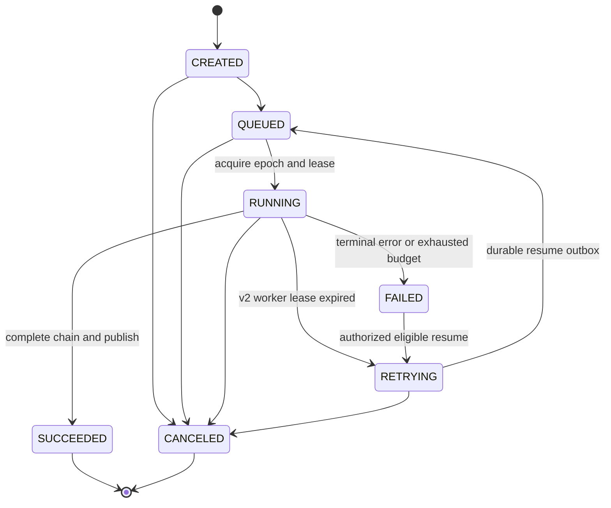
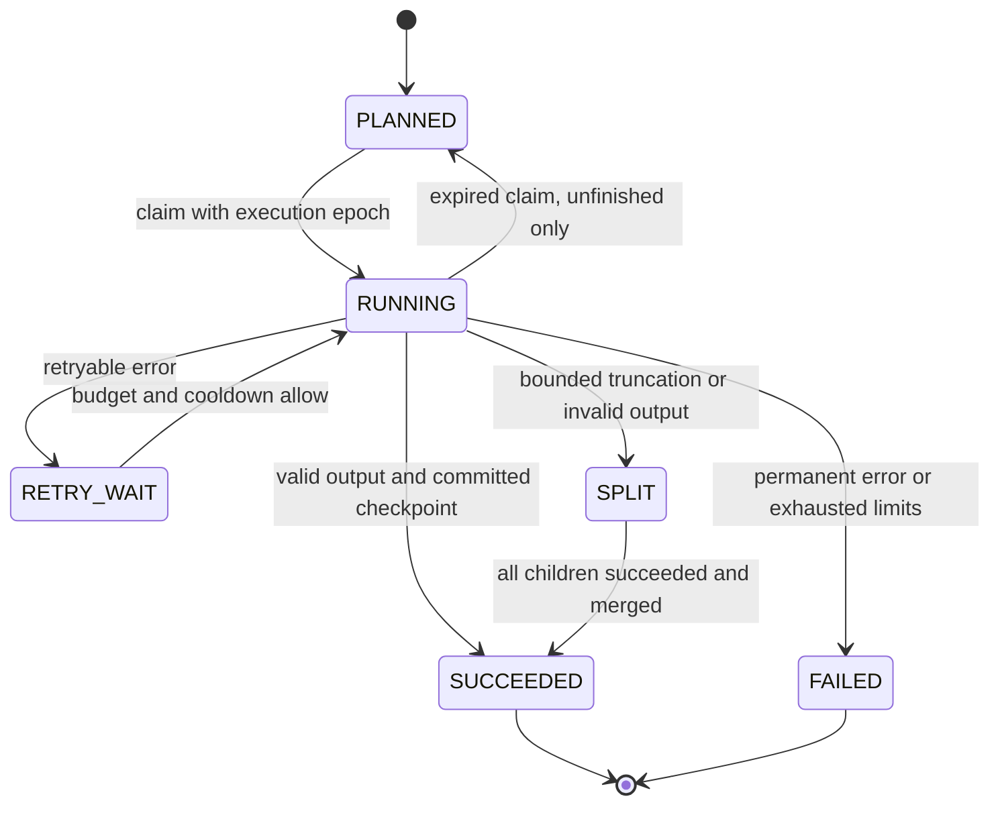

# P2-1：处理链改造设计（待确认，未实施）

设计查阅日期：2026-10-16（北京时间）。目录时间戳为 UTC。代码基线：`codex/p14-system-model-management`，`a7ad19aebfdf5b56f5212512737c83da414a9339`。

本轮仅阅读代码、既有证据与供应商官方文档，新增本文件。没有修改业务代码、配置、数据库或旧证据，没有运行测试、调用模型、重启、部署或提交。工作区原有未跟踪的 `eval/baseline-deepseek-20261015T185735Z/DIAGNOSIS.md` 保留原样。

## 1. 范围与需要确认的执行差异

本改造属于 Java 的确定性媒体准备流程；不迁移到 Python，不扩展 Study Agent 决策逻辑，不写 Python/PostgreSQL 状态。它为后续学习引用提供可追溯的课程原文、译文和时间区间，不能据此宣称 Agent 学习质量通过。

有三处需要在确认设计时一并明确：

1. **翻译实际在 Java，不在 agent-service。** 断点续跑应中断隔离验收的 Java worker。单独 kill Python agent-service 不会中断翻译，也不能证明该流程可恢复；可将其作为 mock 负向测试，但不据此通过恢复验收。不会中断现有线上 Java、agent、llama、ASR 或受保护容器。
2. **百炼当前不返回可用的句级时间戳。** 对该路径采用“先按静音切音频、再逐片 ASR”，记录音频区间来源；不能按字符比例虚构细粒度时间。它会改变 ASR 请求数量，须单独记录成本和耗时。
3. 建议正式基线为 **10 次不注入故障的完整链路**，另加 **1 次同源课程的故障恢复演示**，合计最多 11 个任务。恢复演示独立列报，不混入正常基线均值。真实调用在相关测试通过、磁盘允许且重启范围经确认后进行。

不改系统模型绑定；沿用用户指定的 v10、`DATABASE`、`deepseek-flash`。这是用户陈述及 P1-3d 证据中的身份，本轮没有连接线上 DB 再确认；实测前必须通过脱敏接口重新核对，不符合即停下，不自行改绑。问答、资料、章节、视觉、逐段翻译和用户 decision/review 保持各自路由与默认行为。LangChain4j 继续默认关闭。

## 2. 现状与代码依据

下表路径均相对仓库根目录，行号以本设计代码基线为准。Java 文件前缀为 `backend/src/main/java/com/example/courselingo/`；标注 `resources/` 的路径位于 `backend/src/main/`。

| 位置（文件:行号） | 现有行为 / 拟改动 |
| --- | --- |
| `subtitle/service/SubtitleTranslationServiceImpl.java:318`、`:423`、`:1045` | 全文入口；按固定条数/字符规划，在内存收集所有结果；新增 v2 翻译协调器，保留旧入口兼容。 |
| 同文件 `:579`、`:610`、`:645`、`:994`、`:1168` | 已有语义重试、递归拆分和 length 判断；但客户端可在返回前因空 content 抛错。统一分类和预算，避免 HTTP 重试×语义重试×拆分相乘。 |
| 同文件 `:337`、`:345`、`:1258` | 最终覆盖率、长度/语言等检查；继续严格执行，不以空结果、reasoning 或残缺 JSON 代替译文。 |
| `subtitle/service/SubtitleTranslationPromptFactory.java:100`、`:142`、`:182` | 对齐格式是 `segments[index,text]`；固定模板并记录版本/哈希，保留批次局部索引与全局源索引映射。 |
| `systemmodel/SystemModelChatClient.java:68`、`:111`、`:116`、`:129` | DB 路由请求和响应校验；先取 usage/finish_reason，再判断 length、空输出及 JSON。仅 v2 全文调用添加 DeepSeek 参数。 |
| `ai/llm/OpenAiCompatibleRequestOptionsAdapter.java:17` | 当前仅对 Qwen3 关闭 thinking；增加明确的 DeepSeek 全文调用策略，不凭任意模型名给所有兼容供应商添加参数。 |
| `ai/llm/OpenAiCompatibleLlmProvider.java:46`、`:117`、`:207` | ENV 路径还有自身重试/响应格式兼容行为；v2 的单次调用契约须同时覆盖此路径，旧路径不变。 |
| `systemmodel/SystemModelLlmProvider.java:59`；`SystemModelExecutionService.java:46`、`:98`、`:109` | 已有 DB/ENV/Mock 解析及不可变版本凭据解析；恢复复用既有 snapshot，不重新 freeze，不读取当前绑定。 |
| `ai/asr/BailianAsrProvider.java:70`；`task/runner/TranscribeAudioStep.java:373`、`:517`、`:723`、`:837` | 百炼返回 `(0,0,text)`，合并器用分片或均分区间兜底；新增时间来源，拒绝把均分结果当作句级实测时间。 |
| `media/FfmpegAudioChunker.java:28` | 目前固定时长切分；新增有界 `SilenceAudioChunkPlanner`，沿用 FFmpeg 进程执行边界。 |
| `subtitle/domain/SubtitleSegment.java:24`；`subtitle/service/SubtitleSegmentPersistenceServiceImpl.java:46` | 已存毫秒起止；保存转写会替换原分段并触发版本变化，恢复时不能无条件重跑。 |
| `subtitle/service/SubtitleTranslationPersistenceService.java:49` | 最终双输出事务会变更 content revision；检查点私有落库，整节完整后才走最终发布事务。 |
| `task/runner/PipelineAnalysisTaskWorkExecutor.java:79`、`:167`、`:185` | 步骤完成列表仅在内存；失败会清理关键帧 Evidence，finally 清理工作区。新增检查点恢复与按恢复资格区分清理。 |
| `task/runner/AnalysisTaskRunnerImpl.java:115`、`:230`；`task/service/TaskExecutionLease.java:27`、`:74` | 任务只允许首次执行；lease 过期转 FAILED。增加 v2 epoch/CAS 和同任务恢复，旧任务仍按原规则。 |
| `task/service/TaskCommandServiceImpl.java:88`；`task/controller/TaskCommandController.java:24` | 原 retry 创建新 task ID；保持不变，另加 owner 校验的 resume 接口。 |
| `task/service/GenerationFence.java:28`、`:43`、`:65` | 版本、generation、删除及 lease 约束；恢复后旧 worker 必须失去写入与最终发布权限。 |
| `mq/RocketMqAnalysisTaskMessageConsumer.java:53`、`:80`；`task/service/DurableTaskOutbox.java:94`、`:115` | 脏业务消息可 ACK；outbox 有界重试后 DEAD。恢复消息增加 epoch，不能依赖旧消息无限重投。 |
| `subtitle/diagnostic/TranslationCallDiagnostics.java:37`、`:61`、`:126`；`resources/db/migration/V26__translation_call_diagnostic.sql:2` | 已按物理调用保存基本 usage 与脱敏截断响应，但写入是 best effort；升级为调用前登记、结果入账，保留诊断与计费不同职责。 |
| `ai/llm/LlmUsage.java:3`；`task/runner/PipelineAiCallRecord.java:108`、`WriteAiCallRecordStep.java:77`；`ai/record/dto/FailAiCallRecordCommand.java:3` | 用量只有三项，失败阶段未透传已知 token；增加可空 reasoning/cache 细项，失败汇总引用调用账本。 |
| `task/runner/GenerateLearningPackageStep.java:46`、`:70`；`systemmodel/SystemModelChatClient.java:98`、`:106` | 资料生成失败捕获点与原始响应所在边界；阶段 5 增加仅私有、有界脱敏的 400 诊断，不更改资料生成请求或失败策略。 |
| `resources/application.yml:216`、`:240`、`:352` | 全文默认 120s/15m、1024 输出 token、单条批次；YAML 并发默认 4，但属性类默认 1、历史部署为 1，P1-3d 实际 max_tokens=3072。v2 默认值显式冻结，不能混称这些值相同。 |

新增主要类（尚无文件/行号）：`TranslationPolicySnapshot`、`TranslationTokenBudget`、`TranslationFailure`、`TranslationBatchCoordinator`、`SilenceAudioChunkPlanner`、`TranscriptParagraphService`、`TranslationCheckpointStore`、`PipelineResumeService`、`TranslationAttemptLedger`。尽量在现有子包内实现，不引入第二套 Agent runtime。

已有根因证据：[REPRO.md](../baseline-deepseek-20261015T185735Z/REPRO.md)。其中一次 HTTP 200 返回空 content、非空 reasoning、finish_reason=length，usage 为 903/3073/3976。3073 是供应商原值，不能改写成请求上限 3072，也不能在没有细项时全部当成 reasoning tokens。历史 P1-3b 未保存全部原响应，不能把十次失败追认成同一精确子项。

## 3. 总体方案与冻结身份

新流程默认关闭，拟配置 `courselingo.pipeline.translation-v2.enabled=false`；隔离验收实例显式开启。新任务冻结两类独立身份：

- 既有 `system_model_execution_snapshot`：snapshot ID、系统 configVersion、各功能的无密钥解析结果。
- 新 `pipeline_policy_snapshot`：每任务不可变的 engineVersion、policyHash、promptHash、tokenizer 身份/哈希、切分/批量/重试/AIMD/预算参数、定价引用和媒体身份。ASR 完成后在不可变翻译计划中固定源分段及其 hash。

快照和检查点均不保存明文或加密凭据；仅通过冻结的 configVersion，在既有不可变系统版本中由服务进程按需解密。查询接口只能返回安全 DTO（密钥信息仍限 hasKey/keyLast4）；不返回版本配置原文、响应摘录、请求头、内部 policy 凭据引用或密文。ENV 路径恢复时若部署环境身份已变化，明确 `ENVIRONMENT_DRIFT` 失败，不读取新配置继续运行；缺失历史版本或无法解密同样失败，无供应商/Mock 回退。

v2 的执行参数必须随任务冻结，恢复不能从当前 YAML 重新计算。当前系统 v10 不因新增执行策略而生成 v11；`configVersion` 与 `policyHash` 分开报告。已存在的旧任务不补做新切分，不伪造旧检查点。

步骤顺序仍为：验证/源媒体 → 音频与视觉准备 → ASR → 原文持久化 → 全文翻译 → 融合/资料等后续步骤。视觉分支并发行为保持已有设计。翻译内部为：固定源身份 → token 规划 → 有界调度 → 每次调用入账 → 每批校验/检查点 → 全量覆盖检查 → 原子发布 → 后续步骤。

## 4. 阶段 1：非 thinking、动态输出预算、错误策略

### 4.1 DeepSeek 请求契约

2026-10-16 查阅 [Thinking Mode](https://api-docs.deepseek.com/guides/thinking_mode/) 与 [Chat Completions API](https://api-docs.deepseek.com/api/create-chat-completion/)。官方 Chat Completions 使用 `thinking.type=disabled`，默认启用 thinking；JSON mode 仍需 prompt 明确要求 JSON，length 表示输出预算或上下文限制导致截断。

Java 原始 HTTP JSON 顶层增加：

```json
{"thinking":{"type":"disabled"},"response_format":{"type":"json_object"}}
```

SDK 文档中的 `extra_body` 是 SDK 参数，不是在 Java HTTP body 外再套一层。策略仅对 v2 的 `TRANSLATION_FULL_TEXT` 且明确识别为官方 DeepSeek 的路由启用；不新增协议类型，不改变其他功能，也不使用 reasoning_content 作为译文。Mock 通过显式测试能力标记验证同一请求契约。

### 4.2 输入计数与输出预算

新增可注入 token counter，统计完整 system/user 消息、JSON 索引及协议开销；固定 tokenizer 文件、模板、算法版本与哈希。优先使用经核对与当前模型匹配的官方离线 tokenizer，依据 [Token Usage](https://api-docs.deepseek.com/quick_start/token_usage/)（2026-10-16）。不能将通用 OpenAI tokenizer 或字符数宣称为 DeepSeek 精确计数。

实现阶段验证官方 tokenizer 对当前 Flash 版本的适用性及 Java 依赖体积，使用离线 fixture 校验。无法取得匹配 tokenizer 时允许显式 `CONSERVATIVE_ESTIMATE` 模式，以保守估算规划并记录方法和估计误差；正式测量必须披露该限制，不能把估计值计入实际 usage/费用。所有实际用量以供应商 usage 为准。下载新 tokenizer/依赖前同样检查磁盘，不在本轮下载。

拟公式（参数全冻结）：

```text
T_in = ceil(1.10 × count(full_messages_with_overhead))
M_target = clamp(ceil(2.0 × T_in + 128), 512, 8192)
M_effective = min(M_target, frozen_route_output_cap_if_set)
require T_in + M_effective + 512 <= frozen_context_limit
```

本地估计用于规划，不表示能事先获得服务器精确 prompt_tokens。路由已有显式较小输出上限时不绕过它：优先减小批次；若连最小子片也不满足安全预算，报 `OUTPUT_BUDGET_TOO_SMALL`，不静默使用别的供应商。阶段 1 保持原批次入口，先改善每批输出预算；阶段 3 才更换整体装箱策略。

### 4.3 分类优先级与唯一重试控制器

HTTP 成功且外层可解析时，先提取 usage、finish_reason、provider model、response ID，再校验译文；`length` 优先于空 content/内层 JSON 错误。一个物理调用只有一个主错误类别，另存校验子项，避免重复计数。无可解析响应时 usage 为 NULL。

| 主类别 | 策略（同一冻结版本） |
| --- | --- |
| `TRUNCATED` / finish_reason=length | 不原样重发；按 token 权重二分，父批标 SPLIT；单源项按句界/安全字符边界拆文本子片，最后恢复该源项的一份译文。 |
| `EMPTY_OUTPUT`，且非 length | 同叶批最多原样重试 1 次，仍为空则有界拆分；不能把空字符串视为成功。 |
| `FORMAT_INVALID` | 区分外层 JSON、字段、索引/数量；最多 1 次格式纠正调用，保留相同源内容和严格 schema，再失败则有界拆分。 |
| `VALIDATION_INVALID` | 保留现有长度/语言/完整性规则；最多 1 次语义纠正，再失败则有界拆分，不放宽阈值。 |
| `TIMEOUT` | AIMD 减半（阶段 3）；有界退避后重试，耗尽则明确失败，不把整任务 deadline 重置。 |
| `RATE_LIMITED` / 429 | AIMD 减半；尊重有界 Retry-After 和冷却，不能立即形成重试风暴。 |
| `UPSTREAM_5XX` | 有界指数退避及 full jitter；不切换供应商。 |
| 401/403、模型不存在、其他确定性 4xx、解密失败 | 立即明确失败，无自动拆分、Mock 或供应商回退。 |
| `CANCELED`、源变化、过期 epoch、删除 | 停止派发和写结果；取消不自动恢复。 |

每叶节点最多 3 次物理调用（原样、纠错、网络重试共享），最大拆分深度 6；任务另设总调用数和 token 预算，拆分子节点不能使预算失效。v2 底层 provider 每次只做一个物理请求，所有重试由协调器控制，避免旧客户端隐藏 429/timeout，且每次尝试可观察。旧功能的 HTTP 重试/兼容模式不变。响应格式不支持的确定性 400 在 v2 明确失败，不自动降级成 TEXT。

## 5. 阶段 2：静音、原子分段与时间区间

时间统一内部毫秒；对外增加秒级区间（起点向下、终点向上取整覆盖原区间），保留毫秒原值与 `timingSource`，秒显示精度不等于词级定位精度。

- 已有可靠 ASR 细分时间戳：验证单调性、音频长度边界和非空区间，结合停顿聚合段落。不得将均分兜底当成该能力。
- 百炼等没有细分时间戳的适配器：FFmpeg `silencedetect` 先规划小音频片，沿用冻结 ASR 工厂逐片识别，每片 transcript 对应真实音频起止区间。每片内部没有句级时间就标为 `SILENCE_CLIP_INTERVAL`，不再二次按字数制造时间。
- 若单个 ASR 原子段超出最大段长，且内部没有可信句界时间，则对该音频范围重新切片识别；不能只切文本并声称时间精确。额外调用记入 ASR 成本。

拟静音默认参数：阈值 -35 dB、最短静音 600ms、最短段长 15s、目标 30s、最长 60s。优先在静音中点切；无停顿时按最长限制切片。尾段、极短独立语音和供应商文件大小限制可低于最短值，必须记录 `shortReason`；不可为满足最短值跨越很长无声区间。全静音不发 ASR 请求，明确 `NO_SPEECH`。本阶段不引入新 VAD 模型或下载媒体。

音频切片连续、默认无重叠，保留绝对 offset；依供应商文件大小上限再分片。最大音频片数拟为 256（原默认 180，仅 v2 策略改变），超限明确失败。ASR 并发沿用冻结原配置，不套用翻译 AIMD，不在一任务内混用 ASR 供应商。

原子源段仍是现有 subtitle_segment 的稳定索引；新增 paragraph/member 记录聚合关系。模型输出保持**每个原子源段一份译文**，段落原文与段落译文分别按相同成员顺序拼接，形成一一对应的 paragraph。递归拆译的文本片只有源段内字符范围，不新增更精细的时间区间；必须合并后才成为该源段的完成结果。

现有字幕接口字段和语义保留；全文结果新增可选 `alignedParagraphs`（paragraph ID、原文、译文、start/end millis 与 seconds、timingSource、来源成员身份）。仅对任务 owner 返回，未完成任务不暴露半成品。为 P2-2 保留引用身份和来源版本，本阶段不实现引用 UI 或新的检索算法。检测/切片的 FFmpeg 参数使用参数数组，不拼接 shell，进程时间、stderr 与文件输出有界。

## 6. 阶段 3：token 装箱与 AIMD

按照源段顺序贪心装箱，每次加入源项后重新计算完整消息 token 预算；不能以固定条数作为主预算。默认输入预算为 2048（含 prompt），还要满足输出预算及上下文余量。单项超限先做有界文本拆分，保存映射，再装箱。索引/目标语/任务与配置版本不同的内容不能混批；结果按源索引合并，不按完成顺序。

| 冻结配置 | v2 拟默认值 / 约束 |
| --- | --- |
| `input-token-budget` | 2048；不超过冻结上下文限制，须容纳固定模板。 |
| `output-min/max`、`output-ratio/slack` | 512/8192、2.0/128；受 DB 路由上限约束。 |
| `token-safety-factor`、`context-reserve` | 1.10、512；计数方法和版本入快照。 |
| `concurrency-min/initial/max` | 1/1/4，最大可配置且启动验证范围 1–16。 |
| `success-streak-to-increase` | 连续 3 个校验成功的物理调用后窗口 +1，至上限；错误重置 streak。 |
| `multiplicative-decrease` | 429 或 timeout：`max(1,floor(window/2))`，进入冷却。 |
| `process-provider-max-inflight` | 默认 4，按 provider 身份共享进程级 permit；不是每任务各放大一遍。 |
| `retry-base/max-delay` | 1s/30s，full jitter；Retry-After 超过剩余预算则失败而非提前违规重试。 |
| `leaf-max-attempts`、`split-max-depth` | 3、6；所有原因共享每叶调用额度。 |
| `task-max-physical-calls`、`task-token-budget` | 256、200000；失败/恢复共享，未知用量按预留预算约束，不能记成零释放额度。 |
| 请求、全文、整任务预算 | 沿用冻结现有请求 120s、全文 15m；全文首次进入时固定绝对 deadline，整任务从首次提交起硬上限 30m。重试、冷却、恢复等待均不重置 deadline，不延长。 |

以上是新候选参数，不表示当前线上参数已改变。模型上下文上限来自冻结路由/能力；未知时使用明确保守上限，不能把官方最大上下文直接变成默认请求体大小。

窗口改变只影响后续派发，不取消已健康运行的请求。相同拥塞窗口内并发返回的多个失败只执行一次窗口减半；事件带 windowEpoch，以免旧响应反复减半。每个响应仍各自入账、计重试；5xx 使用退避但默认不触发额外 AIMD 减半。恢复后从窗口 1 启动，记录 `RECOVERY_RESET`，不改变冻结算法参数。

记录 scheduler 原始事件：事件序号、task/batch/attempt、时间、windowEpoch、old/new window、inflight、成功 streak、错误类别、cooldown、系统版本及 policyHash。正式数据输出 JSONL，可直接画并发变化曲线。当前实现仅进程内共享并发上限，不承诺跨实例全局限流；恢复正确性由 DB 锁/CAS 保证。

## 7. 阶段 4：持久化、状态流转和恢复

### 7.1 状态图



这里复用已有 task 状态；只有明确标记 v2 且具备检查点的任务走同任务恢复。旧任务 lease 过期仍 FAILED、原 retry 仍创建新任务。超过原始 30 分钟、取消/删除、源改变、历史配置不可用或预算耗尽时不得恢复；lease 恢复次数拟最多 3 次，超过明确失败，避免崩溃循环。



SPLIT 父批不是一次供应商成功；子批独立有稳定序号，最终只计算不重叠叶节点的源覆盖。用量则包含父批和所有失败/成功子调用。

### 7.2 批次幂等与恢复算法

1. 在首次翻译前持久化不可变 plan：task、owner、snapshot、configVersion、policyHash、sourceFingerprint、targetLanguage、初始批次及 requestHash。批次幂等唯一键严格为 **(task_id,batch_no,config_version)**；一个任务只允许一个冻结计划。批次序号全任务唯一，拆分通过锁定计划计数器分配，另设 `(parent_batch_no,child_ordinal)` 唯一约束，重复拆分不产生第二组子节点。
2. 物理尝试有独立 attempt ID、attempt_no 与执行 epoch。调用前事务登记 STARTED、预留预算，提交后才出网；成功结果、usage 与 batch SUCCEEDED 在同一事务提交。已提交 SUCCEEDED 的源范围与结果哈希不可覆盖。
3. worker 启动/恢复时只读取旧 snapshot 与 policy；检查 owner、删除、冻结输入 hash、模板/算法版本是否可执行，校验任务截止时间。不能调用读取 current-head 的 freeze 方法重新选择配置。
4. 从持久化转写和步骤 checkpoint 恢复 context，跳过已完成的 ASR、PERSIST_SUBTITLES 和翻译批次；不重新保存 ASR 触发源版本更新。内存中的未来任务/future 不作为完成证据。
5. 内容身份按媒体 hash、原子源段索引/文本/时间 hash 判断。`content_revision` 还会因翻译/视觉派生写入变化，不能将它单独当成源转写身份。最终发布仍重取并验证现有 GenerationFence ticket。
6. 所有结果与最终发布写入须同时校验 task owner、未删除/未取消、executionEpoch、当前 lease 与 sourceFingerprint。旧 worker 延迟返回可追加已发生调用的用量事实，但无权写译文、推进批次或发布；取消后的计费事实只在任务仍存在时保留，删除后不重建记录。
7. 未完成批次重试前确认旧 lease 过期并用 CAS 取得新 epoch；DB 使用数据库时间。保留当前 90s lease、15s heartbeat、30s recovery 默认，不借续跑延长模型超时。所有 checkpoint 写入/领取/关闭也带 epoch，不能让旧 finally 关闭新 lease。
8. 全部必需源范围覆盖、所有叶节点有效后，按源顺序合并并执行现有整节校验，再一次性发布字幕、全文和段落映射。失败批次结果不进入正式 Evidence/检索。

调用前登记不等于外部 exactly-once。若供应商已收到请求而进程在落库前崩溃，恢复只能将该 attempt 标记 `UNKNOWN_OUTCOME`；未完成批次可能再次计费。不能承诺消除这类窗口，不能凭估算补成实际 usage。**保证的是 DB 已提交完成的批次不再调用**，而不是所有网络请求绝不重复。

### 7.3 MQ、API、清理边界

- v2 消息携带 protocolVersion、task ID、snapshot ID、epoch、事件 ID；生产与隔离验收使用不同 topic/group。重复或旧 epoch 消息只有在 DB 证明已处理/已失效时 ACK；有效未完成消息持久化恢复意图后才 ACK。不得让旧消费者把新协议消息当脏消息吞掉。
- 同任务恢复继续使用 durable outbox，在恢复事务内更新 epoch/状态并插入事件；以 `(task,epoch,eventType)` 去重，沿用有界投递和 DEAD 错误，不给旧 P1 基线重投。
- 新增 `POST /api/tasks/{taskId}/resume`，输入 `expectedExecutionEpoch`；未登录 401、非 owner 404、状态/epoch 冲突 409。认证失败和配置失效不能通过 resume 跟随新绑定；原 `retry` 创建新任务语义保留。任务取消/删除永不被恢复扫描重新激活。
- 原失败清理删除的是关键帧及其对象，工作区清理还会丢失本地中间产物。对可恢复 v2 任务，把必需媒体/Evidence 的引用和持久化步骤结果登记为 checkpoint，避免提前清理；临时音频可从固定源重建，不等于重新 ASR。最终失败、预算耗尽、取消/删除按原授权边界清理；终止清理不得删源上传，也不得让孤立私有 checkpoint 永久泄漏。按任务截止时间加有界保留期清理，仅限新候选自产物。
- 视觉分支中断恢复至少保留已经持久化的 keyframe/OCR/分析身份；尚未完成部分按原冻结配置补做，不能因旧 failure cleanup 把已提交 Evidence 全删掉后仍跳过步骤。素材存在性与 hash 不符时明确失败/重建可重建步骤，不能引用悬空对象。

## 8. 数据表及 Flyway 计划

当前最后迁移是 V26。本设计只提出 V27–V31，不创建或执行 SQL；若实施前出现其他迁移，顺延编号。所有新增运行状态归属 Java/MySQL，源课程与用户权限保持既有所有权。只做增量迁移，不改写 V22–V26，不回填历史失败试次为成功。

| 阶段 / 拟迁移 | 表与必要字段、约束 |
| --- | --- |
| 1 / `V27__pipeline_policy_snapshot.sql` | `pipeline_policy_snapshot`：task_id PK/FK、user_id、snapshot_id、config_version、engine_version、policy_json、policy_hash、prompt_hash、tokenizer_identity、media_hash、deadline、created_at。每任务 INSERT 一次不可变；不含凭据。 |
| 2 / `V28__transcript_paragraph_alignment.sql` | `transcript_paragraph`：task/source_fingerprint/paragraph_no 唯一，start/end_ms、timing_source、short_reason；`transcript_paragraph_member`：paragraph_id + ordinal PK，原子源索引/源 hash。段落译文通过相同成员的最终字幕译文构建，避免维护第二份独立翻译。保存切片计划 hash 与时间来源。 |
| 3 / `V29__translation_scheduler_observation.sql` | `translation_scheduler_state`：task PK、window_epoch、window、streak、cooldown_until、revision；`translation_scheduler_event`：task+event_seq 唯一、batch/attempt 引用、old/new window、inflight、reason、时间。可恢复事件顺序，阶段 4 补充 epoch 约束。 |
| 4 / `V30__pipeline_translation_checkpoint.sql` | `translation_plan`：task PK、snapshot/config/policy/source 身份、target、plan_hash、next_batch_no、translation_started_at/deadline、预算已用/预留、恢复次数；`translation_batch`：task/batch_no/config_version 唯一、parent/child、depth、源范围、request/result hash、状态、result_json、claim_epoch/lease、attempt_count 与错误；`translation_attempt`：attempt UUID PK、task_id/batch_no/config_version 关联批次、attempt_no、execution_epoch、STARTED/FINISHED/UNKNOWN、HTTP/finish/error_category、基本 usage、耗时、时间，批次内 attempt_no 唯一。 |
| 同阶段 4 | `pipeline_step_checkpoint`：task+step 唯一、source/result hash、持久化结果引用、completed_at、epoch；在 `task_execution` 增加 protocol_version、execution_epoch，并为恢复 outbox 添加可唯一约束的 task/epoch/type 身份。结果和步骤领取用事务/CAS。 |
| 5 / `V31__translation_usage_price_ledger.sql` | 扩充 `translation_attempt`：reasoning_tokens、cache_hit/miss_tokens、usage_status、provider_model/fingerprint、price_card_id、price_tier、cost_lower/upper_usd；`model_price_card`：model/currency/effective_checked_at/source/hash/rates/峰谷规则，不可变。V26 诊断加 attempt_id 关联（可空，历史不伪造）；原 ai_call_record 已有基本 token 列，改失败汇总透传而非另计一份费用。 |

所有运行表关联 task/owner/snapshot；按 task/状态/lease 建索引，父子批引用限同一任务与版本。源文本/有效译文只在业务私有 DB 保存；公开证据只有数量、hash 和来源身份。任务删除联动清理检查点/诊断/成员，保持现有删除流程及对象清理的可重试性；不增加全局“删除所有失败任务”。新表恢复资格和权限必须做真实 MySQL 集成测试，不以 H2 代替锁/唯一键/事务行为。

## 9. 阶段 5：全物理调用用量和费用

账本粒度是每次**真实出网请求**，包括截断父批、失败纠错、429/5xx 与重试。记录输入、输出、推理 token，缓存命中/未命中、耗时、finish_reason、主错误及校验子项；成功结果与失败对象都携带已知 usage。无法取得的值为 NULL，并记录原因（网络断开、非 JSON、供应商未返回、进程中断），不能伪装成零。

V26 的脱敏截断诊断继续支持定位，不能继续用 best-effort 作为完整费用账本。新账本调用前写入失败则不调用；调用后 DB 失败阻止该批发布并暴露 `ACCOUNTING_INCOMPLETE`。崩溃后将未知状态明确列出，不能以再次调用模型来“补用量”。保留原响应最多脱敏后 4000 字符在私有诊断，公开 API/日志/审计不返回原始响应。reasoning 正文无须为了计费继续扩散保存。

官方 [Models & Pricing](https://api-docs.deepseek.com/quick_start/pricing/) 于 **2026-10-16** 查阅：`deepseek-flash` 当前映射 DeepSeek-V4.1-Flash；美元/百万 token 目录价如下。实施/真实测量前复核，保存适用价格卡和来源日期，不能把今日价覆盖历史报告。

| 时段 | 输入缓存命中 | 输入缓存未命中 | 输出 |
| --- | ---: | ---: | ---: |
| 非高峰 | 0.003 USD | 0.15 USD | 0.60 USD |
| 高峰 | 0.006 USD | 0.30 USD | 1.20 USD |

高峰：周一至周五 UTC 01:00–04:00、06:00–10:00，中国法定节假日除外；其余非高峰。按每次调用记录的实际 UTC 时间判断，不按整节课统一猜测；跨时段或节假日无法可靠确认时返回区间并标注不确定，不给虚假的精确账单。

```text
cost_USD = (cache_hit_tokens * hit_rate
          + cache_miss_tokens * miss_rate
          + completion_tokens * output_rate) / 1_000_000
```

根据官方 Chat API 的 completion breakdown，reasoning 是输出细项，不再额外相加收费。缺缓存细项但有 prompt 总量时计算输入费用上下界；缺实际 usage 的调用列为未知费用，已知费用只是下界，不将其称为整节精确费用。重试、拆分父批和失败也计入该节费用；ai_call_record、diagnostic 和 ledger 不重复相加。ASR 和本地资料生成费用单列；DeepSeek 翻译费用不冒充整个处理链成本。

## 10. 分阶段验收与提交

确认后按 1→5 顺序推进并分别本地提交，每次仅包含该阶段代码/迁移/相关测试/小型脱敏证据；运行相关单测及集成测试，保留失败日志，不跑全量。每阶段汇报 commit hash、测试数/跳过数、日志和哈希；重启按用户要求另行确认。真实 10 次基线在阶段 5 冻结后统一运行，不在每个阶段重复消耗同一正式队列。

| 阶段 | 必须通过的验收 |
| --- | --- |
| 1 翻译修复 | mock 请求断言官方 DeepSeek 非 thinking、JSON mode 与动态预算；`content="" + length` 归 TRUNCATED 而非 EMPTY；空、格式/字段/数量/语言、401、429、5xx、超时分类覆盖；深度/调用/截止预算确实终止；路由上限不被绕过；其他功能请求、未启用 v2 时无 DB 绑定行为不变。 |
| 2 切分/时间 | 有停顿、无停顿、全静音、短尾、超长原子段、越界时间、文件上限 fixture；区间有序且覆盖有效语音，短段例外可查；百炼明确标区间来源；源/译文原子索引与 paragraph 成员一一对应，既有字幕输出兼容。 |
| 3 批量/AIMD | 不同长度输入得到 token 有界批次；乱序完成仍按源合并；mock 429/timeout 使窗口按 1/2 规则收缩，连续成功增长且不超上限；延迟响应不重复减半；进程共享 permit、取消、冷却和剩余 deadline 可验证。 |
| 4 续跑 | 真实独立 MySQL：唯一键、双 worker 争抢、旧 epoch 回写、重复/乱序 MQ、通知/重投丢失、lease 恢复；SUCCEEDED 批次零新增 provider 调用；SPLIT 子树可恢复；已完成 ASR 不重跑；最终发布中断可恢复；取消/删除/跨 owner/源变化/过期/预算耗尽不复活；历史系统版本凭据失效明确失败。 |
| 5 用量 | mock 成功、截断、空、格式、HTTP 错误和传输错误均有 attempt；已知 usage 不因业务失败丢失；reasoning/cache 可空且不重复计费；峰谷/跨时段/缺失用量费用正确标注；DB 故障 fail closed，UNKNOWN_OUTCOME 不伪称完整。 |

现有相关测试基点：`SystemModelTranslationObservationTest`、`TranslationCallDiagnosticsTest`、`SubtitleTranslationServiceTest`、`SubtitleTranslationPromptFactoryTest`、`SubtitleTranslationResponseParserTest`、`TranscribeAudioStepTest`、`PipelineAnalysisTaskWorkExecutorTest`、`PipelineAnalysisTaskRunnerFailureTest`、`DurableBoundariesIntegrationTest`、`SystemModelRuntimeMySqlTest`、`SystemModelAsrMySqlTest`。新增对应 TokenBudget/AIMD/SilencePlanner/Checkpoint/UsageLedger 测试（名称实施时确定）。集成库使用独立 MySQL；跳过 DB 测试不算通过。

仅在触及 Agent/Python 运行时代码时增加对应 Python/PostgreSQL 相关回归；本设计不触及它，也不重跑无关全量。机械通过不等于真实译文质量通过；正式报告另做完整性、语言和抽样含义核查，保留所有失败试次。

## 11. 十次基线与一次恢复演示

### 11.1 前置与隔离

- 使用 `eval/baseline-asr-20261015/assets.lock.json` 的同 5 节媒体及 SHA256，每节 2 次，保持顺序/身份可复现；只读引用既有合法媒体，不复制下载、不上传重复大文件。ASR 切分改变在对比中明确列为变量，不能把全部提升只归因于翻译模型。
- 新建隔离验收 Java worker、独立 MySQL schema、Redis namespace、MQ topic/group、对象前缀与端口；不改生产启动器，不连接生产消费组，不碰 demo/acceptance、grok/samescale 受保护对象。新实例启动/停止/故障注入前单列影响范围并等用户确认；本设计确认不代替后续重启确认。
- 系统 v10 的凭据只允许由服务进程通过既有安全部署引用读取，在隔离私有 DB 保留所需不可变配置版本（如需迁移只能数据库内受控复制密文，不导出配置内容），主密钥经已有受保护部署引用注入；工具/报告不读取环境值、不 dump 凭据表、不输出配置原文、不索取 API Key。此隔离启动方式实施前核对，做不到就停下，不退回生产试跑。
- 试跑前用脱敏 API 证明 snapshot 为 DATABASE / deepseek-flash / v10，并记录其他功能的安全配置 fingerprint；结束再比对。无权以 current head 替换任务快照。
- 单任务首次提交至终态超过 30 分钟即记录失败并取消隔离任务，不延长；全文首次进入起 15m 的绝对 deadline 和单请求 120s 不因恢复重置。正常任务串行提交，翻译内部 AIMD；不再叠加十任务并行。

### 11.2 正常基线记录与统计

`trials.jsonl` 每个提交意图和终态均有稳定 trial ID；关联 lecture/replica/task/snapshot/configVersion/policyHash/sourceHash，记录各步骤 UTC 起止/耗时、原子源段数、paragraph 数、初始批次数、拆分节点数、各类别物理重试、attempt 总量、AIMD 事件路径、已知/未知 usage、费用区间、最终状态及完整链路判定。原始过程另存小型事件 JSONL，不能只保存最后汇总。

分母固定 10，不因失败补跑或剔除。完整链路成功要求 ASR、全文翻译、资料生成均完成且译文覆盖通过；现有视觉降级成功不能算完整链路成功。各阶段报告实际到达样本 n、成功/失败耗时分开，完成样本均值±**样本标准差**（ddof=1），n<2 时标准差 NA；未到达阶段为 NA，不记零。另报十次端到端耗时及超时截断标识。单节两次分别列出翻译时间、费用及均值，不能掩盖失败或未知费用。

对比来源为原 P1-3 和 P1-3b 的 `summary.json`、`trials.jsonl` 及 VERIFY：P1-3 原 10 次全部失败（8 翻译超时、1 资料 400、1 MQ 耗尽）；P1-3b 为 0/10 全链路成功。历史缺失 token/原响应保留未知，不根据新数据补造；旧阶段定义不同时单列口径，失败阶段无完整耗时不能与新成功全链路直接作等价速度比。

资料生成若 HTTP 400：在私有目录保存脱敏响应体（有大小上限和截断标记）、HTTP 状态、模型、最终地址、模板/请求 hash、消息角色/长度、输入/输出上限及安全参数摘要。不保存 Authorization、请求全文或课程全文到 Git，不原样输出异常；如原链路没有安全采集点，只增有界诊断，不改生成参数、重试或业务修复。该试次仍为失败。

### 11.3 恢复演示与可复现 DB 证据

单独的第 11 个任务复用一节媒体。在 mock 验证后，真实任务达到计划的一半、至少 2 个批次已提交且仍有未完成批次时，使用隔离测试 barrier 停止派发，记录安全进程身份，再在用户确认范围内 SIGKILL 隔离 Java worker。恢复同候选实例，检查 lease/epoch/outbox 后续跑，不能新建 task ID 或重新绑定模型。

保存中断前后查询结果与日志（下面为拟表名，命令只在隔离验收库运行）：

```sql
SELECT task_id,batch_no,config_version,status,result_hash,attempt_count
FROM translation_batch WHERE task_id=:task ORDER BY batch_no;

SELECT batch_no,attempt_no,execution_epoch,status,error_category,
       prompt_tokens,completion_tokens,reasoning_tokens,finish_reason
FROM translation_attempt WHERE task_id=:task ORDER BY batch_no,attempt_no;

SELECT task_id,execution_epoch,lease_until,completed_at
FROM task_execution WHERE task_id=:task;

SELECT step_name,result_hash,completed_at,execution_epoch
FROM pipeline_step_checkpoint WHERE task_id=:task ORDER BY step_name;
```

实现时保持这些用于验收的字段名一致，或同步更新报告命令。比较已完成 batch 的 result_hash、attempt_count，证明恢复后这些 batch 没有新增 attempt；未完成调用的未知结果和可能重计费明确列报。核对源索引覆盖、最终译文/段落数量、快照/policy 不变，以及 ASR 无新增调用。故障注入停顿计入该任务原始 30 分钟上限，不能用演示名义延长预算。

## 12. 磁盘、隐私与证据封存

2026-10-16T07:44:59Z（北京时间 15:44:59）只读检查：used=131139330048 字节，`used+available`=154877411328 字节，精确 **84.672987%**；df -h 取整显示 85%。距精确 85% 约 0.47 GiB，本轮小型文档可写，不足以直接承诺构建/隔离数据库和十次媒体处理安全。

按 `100*used/(used+available)` 统一阈值口径。实施前后、每任务前和任务期间至少每 10 秒检查；超过 85% 立即停止新派发/提交并报告，终止本轮隔离测试以停止继续写盘，不删现有证据、不扩大清理范围。真实测试启动还需“距 85% 的可写余量 ≥ max(2 GiB, 估算构建+数据库+单任务峰值临时空间+512 MiB)”。这是执行前置，不是授权自动清理磁盘。

不用 Docker prune、不碰 containerd、不删受保护对象。优先已缓存依赖和只读已有媒体，切片逐个生成并限制本任务临时空间；只清理明确属于本轮的新临时片，保留输入/输出身份与 hash，不删除旧归档。公开评测产物目标上限 100 MiB，私有原文和响应采用有界截断，不复制完整视频或完整日志。

后续证据布局（本轮不创建占位结果）：

```text
eval/p2-1-pipeline-20261016T073754Z/
  DESIGN.md
  VERIFY.md                 # 代码文件/阶段提交、复现命令、测试/原始记录位置
  SUMMARY.md                # 10 次基线、恢复单列、历史比较、限制
  trials.jsonl              # 失败试次同样保留
  stages/                   # 相关测试摘要、请求契约 fixture、安全 DB 投影
  events/                   # AIMD、拆分、阶段耗时与用量投影
  SHA256SUMS
.data/p2-1-pipeline-20261016T073754Z/
  checks/                   # 完整相关测试日志，含失败轮次
  raw/                      # 受限原始响应/请求摘要、DB 快照投影
  RAW_SHA256SUMS
```

每个数字有来源字段、聚合公式和一条重算命令；统计脚本只处理落盘证据，默认不提交新任务。SHA256SUMS 不自包含，最终提交 hash 在提交后汇报并由下一阶段记录，避免自引用。公开原始记录位置不包含凭据。先脱敏再截断/写盘；HTTP header、异常 cause、审计和 shell trace 不得泄露密钥。不读取真实密钥来做扫描比对，测试使用合成凭据证明脱敏及 DTO 无密文。

## 13. 风险与回滚

| 风险 | 控制及回滚 |
| --- | --- |
| 非 thinking 与不同输出预算影响质量 | 保持严格 schema/语言检查，mock 只验机制，真实译文另验。关闭 v2 只影响新任务；旧冻结候选不换策略续跑。 |
| Flash 别名更新、tokenizer 估计或目录价格变更 | 记录 provider model/fingerprint、tokenizer/price card 身份；未知保持显式。正式测量前冻结候选，不能中途调参后混报十次。 |
| 静音切片增加 ASR 请求、词被硬切或短尾 | 时间来源诚实标注、最大时长/片数/文件上限、边界 fixture；记录 ASR 时间与费用，不声称秒显示即秒级准确。 |
| AIMD 引发资源/供应商压力 | 初始 1、进程共享上限、有界退避/总预算；无跨供应商故障转移。 |
| 恢复竞态、旧 worker 回写、取消/删除复活 | DB epoch+lease+owner+source fence；重复消息和故障窗口集成测试。不能只靠 Redis 锁。 |
| 原失败清理与检查点冲突、孤立 Evidence | 可恢复任务保留必需私有引用，最终失败/删除执行受限清理，最终发布仍走版本和删除约束。 |
| 崩溃后不确定计费、DB 不可用 | STARTED 账本与未知状态，不能承诺网络 exactly-once；禁止未知当零或仅靠 best-effort 记录。 |
| 磁盘不足 | 实施/实测前留额外余量；超阈值立即停止，不主动清理已有证据或保护对象。 |
| 新旧 worker/MQ 协议混用 | 隔离 topic/group/schema，v2 消息不得进入旧消费者；回滚前停止并确认无新候选运行。 |

逐阶段回滚采用本地还原该阶段提交或回到前一候选；不 push/merge，不部署生产。Flyway 表保持增量，旧版本不使用新表；不执行 down migration、不 drop ledger，不修改历史 v10。回退 worker 前先停止/排空隔离 v2 任务并保留证据，不能让旧 JAR 接手新协议任务。未结束的冻结 v2 任务只能由兼容同一 policy 的 worker 恢复，或明确终止后另建旧流程任务，不能静默切换算法。

## 14. 当前交付状态

设计待确认，五阶段均未实施，commit hash 均未产生。只有本设计文档新增；没有重新运行基线，也没有创建 VERIFY/SUMMARY/trials 假结果。确认时请一并确认第 1 节的 Java 故障注入替代、音频区间时间来源，以及 10 次正常基线 + 1 次独立恢复演示；确认后从阶段 1 开始，按阶段通过相关测试、分别本地提交并汇报。
